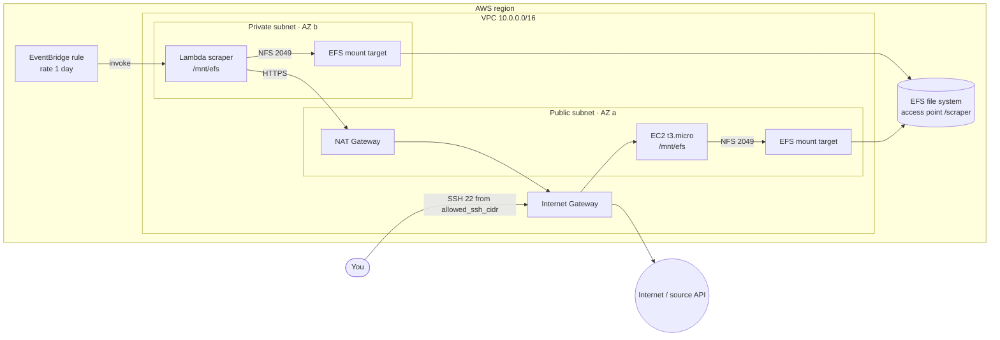

# Scrape to EFS

Terraform for a small, scheduled data-collection pipeline on AWS. A Python Lambda runs in a private subnet on an EventBridge schedule. It fetches a JSON endpoint ([APIs.guru](https://apis.guru/) provider list by default) and writes the result to an encrypted EFS file system. An EC2 instance in the public subnet mounts the same file system, so you can SSH in and inspect the output. The network is a two-subnet VPC with an Internet Gateway and a NAT Gateway, and the Lambda zip, including its `requests` dependency, is built by Terraform.

## Architecture



| File | Contents |
| --- | --- |
| `network.tf` | VPC, subnets, IGW, NAT Gateway, route tables |
| `security_groups.tf` | EC2 / Lambda / EFS security groups and rules |
| `efs.tf` | File system, one mount target per subnet, access point |
| `ec2.tf` | Key pair and inspection instance (mounts EFS via `/etc/fstab`) |
| `lambda.tf` | Package build, IAM role, function, log group, schedule |
| `lambda/` | Handler source and `requirements.txt` |
| `scripts/build_lambda.py` | Installs Linux wheels and the handler into `build/lambda` |

## Prerequisites

- Terraform >= 1.5
- AWS credentials resolvable by the standard credential chain (`aws configure`, `AWS_PROFILE`, SSO, env vars, ...)
- Python 3 with `pip` on your PATH (used locally to build the Lambda package)
- An SSH key pair, by default `~/.ssh/tfkey` / `~/.ssh/tfkey.pub`:
  ```bash
  ssh-keygen -t ed25519 -f ~/.ssh/tfkey
  ```

## Usage

```bash
cp terraform.tfvars.example terraform.tfvars
# set allowed_ssh_cidr to your IP, e.g. "$(curl -s https://checkip.amazonaws.com)/32"
# on Windows also set python_command = "python"

terraform init
terraform plan
terraform apply
```

### Verify

The schedule fires once a day. To skip the wait, invoke the Lambda once by hand:

```bash
aws lambda invoke --function-name "$(terraform output -raw lambda_function_name)" response.json
cat response.json
```

Then SSH into the instance and look at the file:

```bash
$(terraform output -raw ssh_command)
ls -l /mnt/efs
head -c 500 /mnt/efs/providers.json
```

The Lambda logs are in CloudWatch under `/aws/lambda/scrape-to-efs-scraper`.

### Destroy

```bash
terraform destroy
```

## Cost warning

> **The NAT Gateway is billed hourly (about $0.045/h, roughly $32/month in us-east-1) plus data processing, whether or not anything uses it.** Its Elastic IP is billed too. Run `terraform destroy` when you are done. The t3.micro, EFS storage, Lambda and EventBridge cost little or nothing at this scale.

## Design decisions

**Lambda in the private subnet, with a NAT Gateway.** A VPC-attached Lambda only gets private IPs on its network interfaces. In a public subnet it still can't reach the internet, because the Internet Gateway only routes traffic for public IPs. So the function runs in the private subnet, and that subnet's route table sends `0.0.0.0/0` to a NAT Gateway in the public subnet. The Lambda has to be in the VPC at all because it mounts EFS.

**EFS access point.** The Lambda and the EC2 instance both mount the file system through one access point. The access point fixes the POSIX identity at uid/gid 1000 (`ec2-user` on Amazon Linux), which Lambda requires. It also roots both clients at `/scraper` and creates that directory with `0755` on first use. The Lambda's IAM policy allows `ClientMount`/`ClientWrite` only through this access point, not on the file system as a whole.

**One mount target per AZ.** EFS clients connect through a mount target in their own Availability Zone. The EC2 instance (AZ a) and the Lambda (AZ b) are in different AZs, so each subnet gets its own target. This also avoids cross-AZ data charges. The EFS security group accepts NFS (2049) only from the EC2 and Lambda security groups.

## Notes

- The package is rebuilt whenever a file under `lambda/` changes. `build/` is git-ignored. If you apply from a fresh clone against existing state, force a rebuild with `terraform apply -replace=terraform_data.lambda_build`.
- `allowed_ssh_cidr` has no default and rejects `0.0.0.0/0`.
